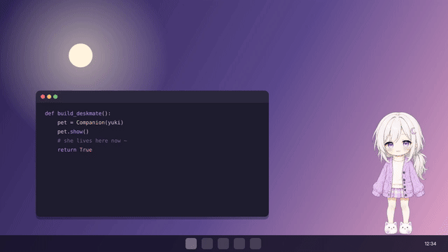
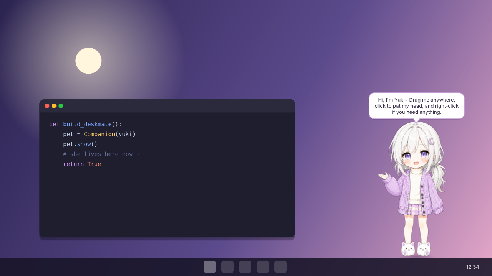
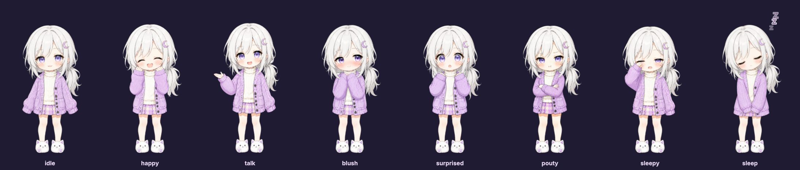

<div align="center">

# 🌙 DeskMate

**A little companion who lives on your desktop.**<br>
She strolls along your taskbar, reacts when you pat her, tumbles if you drop her,<br>
dozes off when you leave, pouts when you ignore her, and reminds you to drink water.




[**Start**](#-start-in-one-double-click) · [**Play with her**](#-play-with-her) · [**Moods**](#-her-moods) · [**Characters**](#-characters) · [**📖 How it works**](TUTORIAL.md)

</div>

---

## ✨ What she does

| | |
|---|---|
| 🪟 **Floats on your screen** | Real transparency (smooth edges, no box), always on top, and she doesn't show up in the taskbar. |
| 🖱️ **Reacts to you** | Click to pat her, drag her anywhere (she swings while you carry her), rest the mouse on her and she gets shy. |
| 🍃 **Feels alive** | Blinks, breathes, and now and then walks along the taskbar on her own (real steps, not sliding). |
| 🪂 **Has gravity** | Drop her in mid-air and she falls to the taskbar with a squash. Fling her and she flies, bounces off the screen edges and lands ("Ow ow ow..."). |
| 😴 **Lives with your day** | Gets sleepy when you step away, falls asleep, and wakes up when you come back. Sleepy late at night too. |
| 😤 **Has feelings** | Pouts if you work for ages without saying hi. One pat and she forgives you. |
| 💧 **Takes care of you** | Gentle reminders to drink water and take a stretch break (can be switched off). |
| 💬 **Talks** | Speech bubbles with a typing effect, from her own lines in `character.json`. |
| 🛡️ **Hard to break** | One copy at a time, safe settings saves, never gets lost off-screen, logs every error, and still starts if images are missing. |

---

## 🚀 Start in one double-click

> **Needs:** Windows 10/11 and [Python 3.9+](https://www.python.org/downloads/) (tick *"Add python.exe to PATH"* when installing).

1. Double-click **`run_deskmate.bat`**.
2. The first time, it sets itself up (about 1–2 minutes, it installs PySide6 into a private `.venv` folder).
3. She appears in the bottom-right corner and says hi. 👋



After that it starts instantly. To start her with Windows, right-click her → **Start with Windows**.

<details>
<summary>Other ways to run it</summary>

```powershell
run_deskmate.bat --console     # same, but with a console window so you can see errors
run_deskmate.bat --test        # run the 50 self-tests

# or by hand, from this folder:
python -m venv .venv
.venv\Scripts\pip install -r requirements.txt
.venv\Scripts\python -m deskmate
```
</details>

---

## 🎮 Play with her

| Do this | She does this |
|---|---|
| **Click** her | Happy hop + a cute line |
| **Click a lot**, fast | "Hey! My hair's getting messy!" 😤 |
| **Drag** her | Surprised face, swings like a pendulum |
| **Let go** in mid-air | She falls to the taskbar and lands with a squash |
| **Fling** her | She flies with your swipe, bounces off the screen edge, and complains a little if she lands hard |
| Leave her be | She blinks, breathes, and wanders to a new spot every minute or two |
| **Rest the mouse** on her | Blushes |
| **Right-click** her (or the tray icon) | The menu ⬇️ |
| Click the **tray icon** | Hide / show her |

**Menu:** Talk to me · Go to sleep / Wake up · Character · Size (small / medium / large) · Always on top · Gravity · Wander around · Chit-chat now and then · Care reminders · Start with Windows · Move back to the corner · Open settings & logs folder · Quit

> Want her to stay exactly where you put her (say, mid-screen)? Untick **Gravity**.

---

## 🎭 Her moods

| Expression | When |
|---|---|
| `idle` | Normal, chilling with you |
| `happy` | You patted her, or she's greeting you |
| `blush` | Your mouse rests on her, or she just forgave you |
| `talk` | She's saying something |
| `surprised` | Being carried, or just woke up |
| `sleepy` | You've been away 5 minutes, or it's after midnight |
| `sleep` | You've been away 15 minutes (or you put her to bed) — with floating *zzz* |
| `pouty` | You've been busy for 45 minutes without saying hi |

All the timings live at the top of [`deskmate/brain.py`](deskmate/brain.py) if you want her more (or less) clingy.

---

## 🎨 Characters

| | |
|---|---|
| **Yuki** 🌙 | Original soft-anime character: silver ponytail, wisteria eyes, mauve cardigan, cat slippers. Sleepy, pouty, caring. Lives in `characters/yuki`. |
| **Piko** 🎧 | Built-in pixel-art girl, drawn entirely in code ([`tools/draw_pixel_character.py`](tools/draw_pixel_character.py)). Used whenever Yuki's folder isn't there. |

Switch any time: right-click → **Character**. New character folders show up in that menu without restarting.



### Make your own

A character is just a folder of transparent PNGs:

```
characters/
└── yuki/
    ├── character.json      ← name, colours, her lines
    ├── idle/idle_01.png    ← the only required picture
    ├── happy/happy_01.png
    ├── sleepy/ sleep/ pouty/ surprised/ blush/ talk/
    └── blink/  walk/ ...   ← several numbered images = an animation
```

- Missing expressions fall back to `idle`, so you can start with one picture.
- Every picture should be the same size, with her feet at the bottom centre.
- Pixel art? Add `"smooth": false` to `character.json` and she stays crisp.
- Check a pack: `.venv\Scripts\python -m deskmate --check characters\yuki`

**Got pictures with a white background?** The clean-up tool does everything for you: it cuts her out with an anime-trained AI model, removes the white fringe, lines every expression up with idle, and writes the pack:

```powershell
.venv\Scripts\pip install -r tools\requirements-tools.txt
.venv\Scripts\python tools\prepare_character.py "C:\path\to\pictures" --name yuki --meta tools\yuki_meta.json
```

(Name the files `idle.png`, `happy.png`, … or pass `--map idle=a.png happy=b.png`.)

**Adding a walk cycle** (or any animation): draw the frames facing right, on a plain background, any size. The tool cuts them out and fits them to her idle picture (same height, same floor, steady head):

```powershell
.venv\Scripts\python tools\add_frames.py characters\yuki walk walk1.png walk2.png walk3.png walk4.png --fps 4.5
```

---

## 🩺 If something's off

| Problem | Fix |
|---|---|
| Nothing appears | Run `run_deskmate.bat --console` and read the message. |
| She's lost somewhere | Right-click the tray icon → **Move back to the corner**. |
| She won't stay where I put her | Untick **Gravity** (and **Wander around** if she walks off). |
| Weird behaviour | Right-click → **Open settings & logs folder** → `deskmate.log`. |
| Start fresh | Quit her, delete `settings.json` in that folder. |

Settings and logs live in `%APPDATA%\DeskMate`.

---

## 🗂️ Inside

```
deskmate/
├── app.py              start-up, menus, tray, wiring everything together
├── companion.py        her see-through window: drawing, animation, mouse
├── brain.py            moods and what to say (pure Python, fully tested)
├── bubble.py           speech bubble with typing effect
├── character.py        loads + checks character packs
├── settings.py         settings with safe saves
├── single_instance.py  only one DeskMate at a time
├── sysidle.py          "is the user away?" (Windows idle time)
├── autostart.py        Start with Windows
└── logsetup.py         log file, even with no console
tools/prepare_character.py   picture clean-up → character pack
tools/draw_pixel_character.py  draws Piko in code
tools/make_blink.py          makes a blink picture from idle + sleep
tools/add_frames.py          adds an animation (like her walk cycle) to a pack
tools/render_preview.py      makes the README pictures from the real windows
tools/render_demo.py         records docs/demo.mp4 + demo.gif from the real window
tests/                       50 tests (python -m unittest)
```

## 🛣️ Next phases

- ✅ **Phase 1 — Companion:** floating window, moods, speech, tray, safe settings.
- ✅ **Phase 2 — Alive:** blinking, gravity, flinging, walking along the taskbar with a real walk cycle.
- **Phase 2½ — Perch:** sit on the top edge of your windows (Windows API).
- **Phase 3 — AI:** chat with her (Claude API or a local model with Ollama), she remembers your day.
- **Phase 4 — Online:** a shared pet for your team on a small server.

---

<div align="center">

Made with ☕ in Johor Bahru by [**@MuizKmz**](https://github.com/MuizKmz) · Yuki is an original character

</div>
