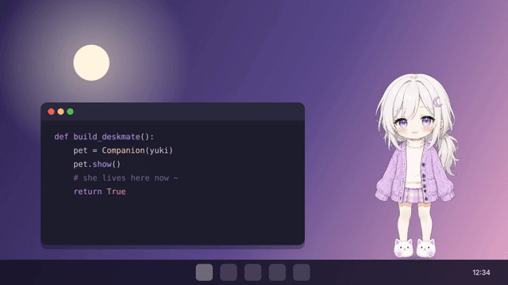
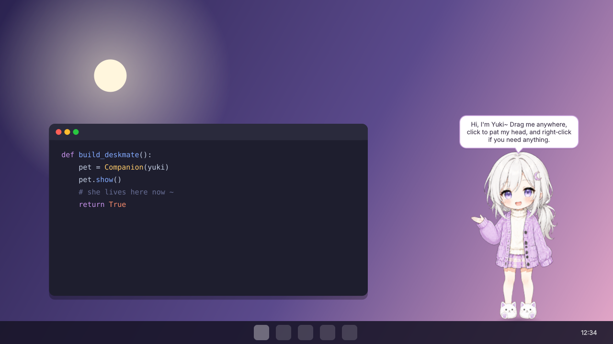
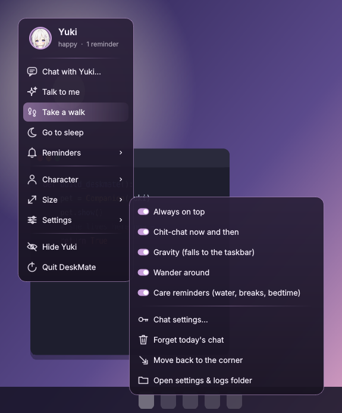
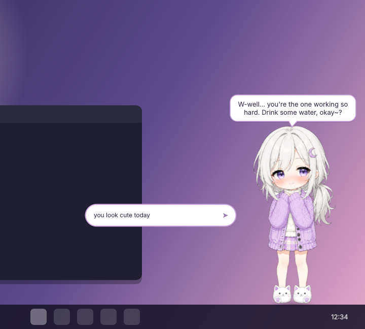
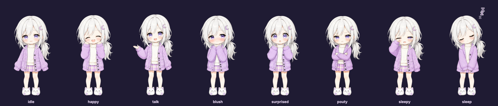

<div align="center">

# 🌙 DeskMate

**A little companion who lives on your desktop.**<br>
She strolls along your taskbar, reacts when you pat her, tumbles if you drop her,<br>
dozes off when you leave, pouts when you ignore her, and reminds you to drink water.

[](https://github.com/MuizKmz/deskmate/releases/latest)


[](https://github.com/MuizKmz/deskmate/actions/workflows/ci.yml)



[**Install**](#-install) · [**Play with her**](#-play-with-her) · [**Chat**](#-chat-with-her) · [**Moods**](#-her-moods) · [**Characters**](#-characters) · [**📖 How it works**](TUTORIAL.md)

</div>

---

## ✨ What she does

| | |
|---|---|
| 🪟 **Floats on your screen** | Real transparency (smooth edges, no box), always on top, and she doesn't show up in the taskbar. |
| 🖱️ **Reacts to you** | Click to pat her, drag her anywhere (she swings while you carry her), rest the mouse on her and she gets shy. |
| 🍃 **Feels alive** | Blinks, breathes, and now and then walks along the taskbar on her own (real steps, not sliding). Waves hello when you come back, yawns when she gets sleepy, stretches with you on breaks. |
| 🪂 **Has gravity** | Drop her in mid-air and she falls to the taskbar with a squash. Fling her and she flies, bounces off the screen edges and lands ("Ow ow ow..."). |
| 🪟 **Sits on your windows** | Drop her above a window and she lands on its top edge. Move the window and she rides along; close or minimise it and down she goes. |
| 😴 **Lives with your day** | Gets sleepy when you step away, falls asleep, and wakes up when you come back. Sleepy late at night too. |
| 😤 **Has feelings** | Pouts if you work for ages without saying hi. One pat and she forgives you. |
| 💧 **Takes care of you** | Gentle reminders to drink water, stretch, and go to bed when you work past 11 pm (can be switched off). |
| ⏰ **Reminds you** | "Remind me at 3pm about the meeting": ask in chat or add one from her menu, and she tells you on time. |
| 💬 **Talks** | Speech bubbles with a typing effect, from her own lines in `character.json`. She can also say them out loud. |
| 🧠 **Chats with you** | Type to her and she answers in character, powered by OpenAI or a free local model (Ollama). Remembers your day. |
| 🛡️ **Hard to break** | One copy at a time, safe settings saves, never gets lost off-screen, logs every error, and still starts if images are missing. |

---

## 🚀 Install

1. Download **`DeskMate-Setup-x.y.z.exe`** from the [latest release](https://github.com/MuizKmz/deskmate/releases/latest). No Python needed.
2. Run it. It installs just for you (no admin password) and can start DeskMate with Windows.
3. She appears in the bottom-right corner and says hi. 👋



> [!NOTE]
> Windows may say **"Windows protected your PC"**, because the app isn't code-signed (signing costs money every year). Click **More info** → **Run anyway**. Every release lists SHA-256 checksums if you want to verify the download.

Prefer no installer? Take **`DeskMate-x.y.z-portable.zip`**, unzip it anywhere and run `DeskMate.exe`.

**Updates:** once a day she checks GitHub for a newer release (just a look at the public Releases page, nothing about you is sent). When there is one, she tells you once and her menu shows **Update to x.y.z...**, which opens the download page. Install the new version over the old one. (Settings › **Check for updates** turns this off.) Your settings, chat history and API key stay in `%APPDATA%\DeskMate`.

<details>
<summary>Run it from the source code instead (to tinker with it)</summary>

> **Needs:** [Python 3.10+](https://www.python.org/downloads/) (tick *"Add python.exe to PATH"* when installing).

Double-click **`run_deskmate.bat`**. The first time, it sets itself up (about 1–2 minutes, it installs PySide6 into a private `.venv` folder).

```powershell
run_deskmate.bat --console     # same, but with a console window so you can see errors
run_deskmate.bat --test        # run the 108 self-tests

# or by hand, from this folder:
python -m venv .venv
.venv\Scripts\pip install -r requirements.txt
.venv\Scripts\python -m deskmate
```
</details>

---

## 🎮 Play with her

| Do this | She does this |
|---|---|
| **Click** her | Happy hop + a cute line |
| **Click a lot**, fast | "Hey! My hair's getting messy!" 😤 |
| **Drag** her | Surprised face, swings like a pendulum |
| **Let go** in mid-air | She falls to the taskbar and lands with a squash |
| **Fling** her | She flies with your swipe, bounces off the screen edge, and complains a little if she lands hard |
| **Drop** her above a window | She sits on its top edge and rides along when you move it |
| Leave her be | She blinks, breathes, and wanders to a new spot every minute or two |
| Right-click → **Take a walk** | She walks along the taskbar right now |
| **Rest the mouse** on her | Blushes |
| **Right-click** her (or the tray icon) | The menu ⬇️ |
| Click the **tray icon** | Hide / show her |

**Menu:** a glass card in her colours, with her face and mood at the top. Chat with Yuki · Today's chat · Talk to me · Take a walk · Go to sleep / Wake up · Reminders · Character · Size · **Settings** › (switches for Always on top, Chit-chat, Gravity, Wander around, Sit on windows, Care reminders, Start with Windows · Voice · Check for updates · Chat settings · Forget today's chat · Move back to the corner · Open settings & logs folder) · Hide · Quit



> Want her to stay exactly where you put her (say, mid-screen)? Settings › switch off **Gravity**.

---

## 💬 Chat with her

Right-click her → **Chat with Yuki...**, type, press Enter. She answers in her bubble, in character, and her face follows the mood of her answer.



The first time, the **Chat settings** box opens. Pick her "chat brain":

| | **OpenAI** | **Ollama** |
|---|---|---|
| Cost | Pay per message (a fraction of a cent) | Free |
| Smartness | Best at staying in character | OK, depends on the model |
| Privacy | Messages go to OpenAI | Everything stays on your PC |
| Setup | Paste an [API key](https://platform.openai.com/api-keys) | Install [Ollama](https://ollama.com), run `ollama pull llama3.2` |

- Leave **Model** empty or click **Pick for me**: DeskMate asks which models your key can use and picks a cheap "mini" one.
- **Today's chat** (in her menu, or the 🕘 button on the chat box) opens a window with the whole conversation as bubbles, with times and any reminders she set. Keep chatting there if you like.
- She remembers what you talked about **today** (even after a restart), and starts fresh tomorrow. Right-click → Settings › **Forget today's chat** to clear it.
- While you chat, she doesn't interrupt with reminders or wander off.
- No key, no internet, out of credit? She tells you in her own words, and everything else keeps working.

> [!IMPORTANT]
> Your key is saved only on your PC, in `%APPDATA%\DeskMate\secrets.json`, never in this folder, so it can't end up on GitHub. Set a monthly spending limit on your OpenAI account to be safe. You can also use the `OPENAI_API_KEY` environment variable instead.

### 🔊 Her voice

Right-click → Settings › **Voice**:

| | |
|---|---|
| **Off** | Quiet (the default) |
| **Windows voice (free)** | The speech engine built into Windows. Works offline, a little robotic |
| **Natural voice (OpenAI)** | A soft, natural voice using your OpenAI key (a fraction of a cent per line). If it can't connect, the Windows voice takes over |

She reads out her **chat replies**. Tick **Read all her lines** to hear her greetings and reminders too. Decorations like `~` and `*yawn*` aren't read out.

### ⏰ Reminders

Ask her in chat: *"remind me at 3pm about the meeting"*, *"remind me in 20 minutes to stretch"*. Or, without any AI, right-click → **Reminders** → **Add reminder...** and type:

| You type | She reminds you |
|---|---|
| `15:00 meeting` · `3pm call mom` · `9am standup` | at that time (tomorrow if it has passed today) |
| `in 20 min stretch` · `20m tea` · `1h30 check the oven` | that long from now |
| `submit report at 3:30 pm` · `call mom in 2 hours` | the time can go at the end too |

When it's time she hops up and tells you. **Reminders** in her menu lists what's coming, and you can cancel any of them. Reminders are saved, so they survive a restart, and if one came due while DeskMate was closed, she tells you when she starts.

---

## 🎭 Her moods

| Expression | When |
|---|---|
| `idle` | Normal, chilling with you |
| `happy` | You patted her, or she's greeting you |
| `blush` | Your mouse rests on her, or she just forgave you |
| `talk` | She's saying something |
| `surprised` | Being carried, or just woke up |
| `sleepy` | You've been away 5 minutes, or it's after midnight |
| `sleep` | You've been away 15 minutes (or you put her to bed) — with floating *zzz* |
| `pouty` | You've been busy for 45 minutes without saying hi |

All the timings live at the top of [`deskmate/brain.py`](deskmate/brain.py) if you want her more (or less) clingy.

---

## 🎨 Characters

| | |
|---|---|
| **Yuki** 🌙 | Original soft-anime character: silver ponytail, wisteria eyes, mauve cardigan, cat slippers. Sleepy, pouty, caring. Lives in `characters/yuki`. |
| **Piko** 🎧 | Built-in pixel-art girl, drawn entirely in code ([`tools/draw_pixel_character.py`](tools/draw_pixel_character.py)). Used whenever Yuki's folder isn't there. |

Switch any time: right-click → **Character**. New character folders show up in that menu without restarting.



### Make your own

A character is just a folder of transparent PNGs:

```
characters/
└── yuki/
    ├── character.json      ← name, colours, her lines
    ├── idle/idle_01.png    ← the only required picture
    ├── happy/happy_01.png
    ├── sleepy/ sleep/ pouty/ surprised/ blush/ talk/
    └── blink/  walk/ ...   ← several numbered images = an animation
                              (optional poses: wave/ stretch/ yawn/)
```

- Missing expressions fall back to `idle`, so you can start with one picture.
- Every picture should be the same size, with her feet at the bottom centre.
- Pixel art? Add `"smooth": false` to `character.json` and she stays crisp.
- Check a pack: `.venv\Scripts\python -m deskmate --check characters\yuki`
- Installed DeskMate? Put your own character folders in `%APPDATA%\DeskMate\characters`. They show up in the menu, survive updates, and a folder with the same name as a built-in one replaces it.

**Got pictures with a white background?** The clean-up tool does everything for you: it cuts her out with an anime-trained AI model, removes the white fringe, lines every expression up with idle, and writes the pack:

```powershell
.venv\Scripts\pip install -r tools\requirements-tools.txt
.venv\Scripts\python tools\prepare_character.py "C:\path\to\pictures" --name yuki --meta tools\yuki_meta.json
```

(Name the files `idle.png`, `happy.png`, … or pass `--map idle=a.png happy=b.png`.)

**Adding a walk cycle** (or any animation): draw the frames facing right, on a plain background, any size. The tool cuts them out and fits them to her idle picture (same height, same floor, steady head):

```powershell
.venv\Scripts\python tools\add_frames.py characters\yuki walk walk1.png walk2.png walk3.png walk4.png --fps 4.5
```

For front-facing poses where her arms go above her head (waving, stretching), add `--fit feet` so she's sized by her slippers instead of her height:

```powershell
.venv\Scripts\python tools\add_frames.py characters\yuki wave wave1.png wave2.png --fps 4 --fit feet --zoom 0.94
```

---

## 🩺 If something's off

| Problem | Fix |
|---|---|
| Nothing appears | Run `run_deskmate.bat --console` and read the message. |
| She's lost somewhere | Right-click the tray icon → Settings › **Move back to the corner**. |
| She won't stay where I put her | Settings › switch off **Gravity** (and **Wander around** if she walks off). |
| Weird behaviour | Right-click → Settings › **Open settings & logs folder** → `deskmate.log`. |
| Start fresh | Quit her, delete `settings.json` in that folder. |
| Chat says the key doesn't work | Right-click → Settings › **Chat settings** → paste the key again → **Test connection**. |

Settings and logs live in `%APPDATA%\DeskMate`.

---

## 🗂️ Inside

```
deskmate/
├── app.py              start-up, menus, tray, wiring everything together
├── companion.py        her see-through window: drawing, animation, mouse
├── brain.py            moods and what to say (pure Python, fully tested)
├── bubble.py           speech bubble with typing effect
├── chat.py             talking to OpenAI / Ollama (pure Python, tested with a fake server)
├── chatbox.py          the chat box, the Today's chat window and the Chat settings dialog
├── menu_style.py       her glass right-click menu (icons and switches drawn in code)
├── character.py        loads + checks character packs
├── settings.py         settings with safe saves
├── single_instance.py  only one DeskMate at a time
├── sysidle.py          "is the user away?" (Windows idle time)
├── autostart.py        Start with Windows
├── perch.py            the window tops she can sit on (asks Windows for the open windows)
├── voice.py            her voice: Windows speech or OpenAI
├── updates.py          "a new me is out!": checks GitHub for a newer release
└── logsetup.py         log file, even with no console
tools/prepare_character.py   picture clean-up → character pack
tools/draw_pixel_character.py  draws Piko in code
tools/make_blink.py          makes a blink picture from idle + sleep
tools/add_frames.py          adds an animation (like her walk cycle) to a pack
tools/render_preview.py      makes the README pictures from the real windows
tools/render_demo.py         records docs/demo.mp4 + demo.gif from the real window
tests/                       108 tests (python -m unittest)
packaging/                   DeskMate.exe recipe (PyInstaller) + installer (Inno Setup)
.github/workflows/           tests on every push; a tagged push builds and publishes a release
```

<details>
<summary>Make a release</summary>

Bump `__version__` in `deskmate/__init__.py` and push. Then on GitHub: **Actions** → **Release** → **Run workflow**. (Or push a tag: `git tag v0.3.0` then `git push origin v0.3.0`.)

GitHub Actions runs the tests on Windows, builds `DeskMate.exe`, makes the installer and the portable zip, and publishes them on the Releases page. To build locally instead: `pip install pyinstaller`, `pyinstaller packaging\deskmate.spec`, then compile `packaging\installer.iss` with [Inno Setup](https://jrsoftware.org/isinfo.php).
</details>

## 🛣️ Next phases

- ✅ **Phase 1 — Companion:** floating window, moods, speech, tray, safe settings.
- ✅ **Phase 2 — Alive:** blinking, gravity, flinging, walking along the taskbar with a real walk cycle.
- ✅ **Phase 3 — AI:** chat with her (OpenAI or a free local model with Ollama), she remembers your day.
- **Phase 2½ — Perch:** sit on the top edge of your windows (Windows API).
- **Phase 3½:** Claude as a third chat brain, a chat log window, voice.
- **Phase 4 — Online:** a shared pet for your team on a small server.

---

<div align="center">

Made with ☕ in Johor Bahru by [**@MuizKmz**](https://github.com/MuizKmz) · Yuki is an original character

</div>
