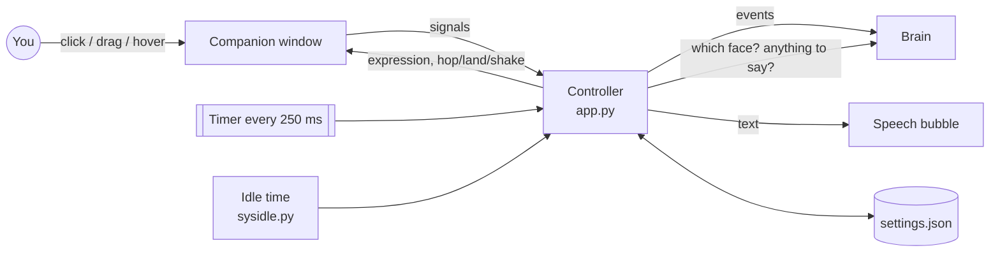

<div align="center">

# 📖 How DeskMate Works

### A guided tour: see-through windows, animation, a testable "brain", and the habits that make an app robust


[← Back to README](README.md)

</div>

> [!TIP]
> Keep the code open next to this page and do the 🧪 experiments. Change a number, run
> `run_deskmate.bat --console`, see what happens. That's how it sticks.

## 🗺️ Map

| # | Chapter | File | You'll learn |
|:-:|---|---|---|
| 1 | [The big picture](#1--the-big-picture) | all | How the pieces talk to each other |
| 2 | [A window you can see through](#2--a-window-you-can-see-through) | `companion.py` | Frameless, transparent, always-on-top windows |
| 3 | [Drawing her](#3--drawing-her) | `companion.py` | Image caching, HiDPI, crossfades, animation maths |
| 4 | [The brain](#4--the-brain) | `brain.py` | State machines you can unit-test with a fake clock |
| 5 | [Talking](#5--talking) | `bubble.py` | A typing effect that doesn't make words jump |
| 6 | [Never break, never get lost](#6--never-break-never-get-lost) | `settings.py`, `app.py` | Atomic saves, screen clamping, logging, one instance |
| 7 | [Character packs](#7--character-packs) | `character.py`, `tools/` | Validating input, and how the image clean-up works |
| 8 | [Your turn](#8--your-turn) | | Challenges with hints |

---

## 1 · 🧩 The big picture



The most important design decision: **the window doesn't think, and the brain doesn't draw.**

- `companion.py` only knows *how to show* things (a picture, a hop, a swing).
- `brain.py` only knows *what she feels*. It has no Qt in it at all.
- `app.py` (the Controller) passes messages between them.

Because the brain is plain Python, all its rules are tested in milliseconds (`tests/test_brain.py`) without opening a single window.

---

## 2 · 🪟 A window you can see through

```python
flags = Qt.WindowType.FramelessWindowHint | Qt.WindowType.Tool | Qt.WindowType.WindowStaysOnTopHint
self.setAttribute(Qt.WidgetAttribute.WA_TranslucentBackground)
self.setAttribute(Qt.WidgetAttribute.WA_ShowWithoutActivating)
```

| Setting | Why |
|---|---|
| `FramelessWindowHint` | No title bar or border |
| `Tool` | No taskbar button |
| `WindowStaysOnTopHint` | Floats above other windows |
| `WA_TranslucentBackground` | Every pixel can have its own transparency (alpha) |
| `WA_ShowWithoutActivating` | Appearing doesn't steal focus from what you're typing in |

On Windows, a window like this becomes a *layered window*: fully transparent pixels let clicks fall through to whatever is underneath. DeskMate also double-checks in `_opaque_at()`, so a click on an empty corner is never treated as a pat.

> [!NOTE]
> Hiding the window must not quit the app, so `app.setQuitOnLastWindowClosed(False)` is set. Only **Quit** in the menu ends it.

<details>
<summary>🧪 <b>Experiment</b></summary>

In `companion.py`, temporarily remove `WA_TranslucentBackground` and run it. You'll see the black box that every desktop-pet beginner meets once. 🙂
</details>

---

## 3 · 🎨 Drawing her

### Scale once, not every frame

Her source images are big (about 1024 px tall) so she stays sharp on 4K screens. Shrinking a big image is slow, so `_pixmap()` does it **once** per size and keeps the result in `self._cache`. It also multiplies by the screen's *device pixel ratio* (1.25 at 125% Windows scaling), so she's crisp, not blurry, on every monitor. Moving her to a monitor with different scaling clears the cache.

### Crossfading faces

Swapping pictures instantly looks cheap. Drawing the old face on top of the new one at 50% looks ghostly. The trick is **Plus** blending in a scratch image:

```python
painter.setCompositionMode(QPainter.CompositionMode.CompositionMode_Plus)
painter.setOpacity(1.0 - k); painter.drawPixmap(0, 0, previous)
painter.setOpacity(k);       painter.drawPixmap(0, 0, current)
```

With pre-multiplied colours, that's exactly `(1-k)·old + k·new`, transparency included, which is a true cross-dissolve over 0.18 s.

### Animation is just maths on time

Nothing is a video. Every frame asks "what time is it?" and computes:

| Effect | Formula (simplified) |
|---|---|
| Breathing | `scale_y = 1 + 0.010 · sin(2π · t / 3.4)` (slower and deeper asleep) |
| Hop | `lift = height · 0.075 · 4p(1−p)` (a parabola, p goes 0→1) |
| Landing squash | `e^(−5p) · cos(3.2πp)` (a wobble that fades out) |
| Swing while dragged | a little spring: speed += (140·(target − angle) − 11·speed)·dt |

Scaling is done around her **feet**, so she breathes upward instead of sinking into the taskbar.

> [!IMPORTANT]
> The timer runs at about 30 fps only while something moves, and drops to about 15 fps when she's just breathing. When she's hidden, the timer stops. A desktop pet must be kind to your battery.

---

## 4 · 🧠 The brain

She has a **base mood** (lasts long) and a **reaction** (short, expires):

```
face = surprised        while you're dragging her
     = reaction         until it expires   (happy after a pat, talk while speaking…)
     = base mood        otherwise          (idle | sleepy | sleep | pouty)
```

`tick(now, user_idle)` runs four times a second and applies the rules in order: sleep/wake → late night → pout → blush → reminders → chit-chat.

### Why `now` is passed in

```python
brain.tick(now=3600, user_idle=1)   # "an hour later", instantly
```

The brain never calls `time.time()` itself. Tests pass in any time they like, so "45 minutes ignored" is tested in a microsecond:

```python
def test_pouts_when_ignored_while_you_work_and_forgives_on_pet(self):
    brain.tick(B.IGNORED_AFTER + 1, user_idle=2)
    self.assertEqual(brain.base, "pouty")
```

This idea, **inject the clock**, is one of the most useful testing tricks in all of software.

### "Is the user away?"

`sysidle.py` asks Windows directly with `GetLastInputInfo`, which covers keyboard *and* mouse. The tick counter is 32-bit and wraps every 49.7 days, so the difference is masked with `& 0xFFFFFFFF`, a classic bug avoided. On other systems it falls back to watching the cursor.

<details>
<summary>🧪 <b>Experiment</b></summary>

Set `SLEEPY_AFTER = 20` and `SLEEP_AFTER = 40` in `brain.py`, start her, and don't touch anything for a minute. Then wiggle the mouse. (Put them back afterwards!)
</details>

---

## 5 · 💬 Talking

The bubble is a **separate** see-through window, so it can sit above her head without making her window bigger. If she's near the top of the screen it moves beside her head instead.

**The typing-effect problem:** if you draw only the first *n* letters, a half-typed word wraps differently from the finished word, and text jumps between lines. The fix is to lay out the **whole** sentence once, then draw the not-yet-typed part with an invisible colour:

```python
hidden.cursor = cursor          # selects letters n..end
invisible.setForeground(QColor(0, 0, 0, 0))
context.selections = [hidden]   # same layout, just not painted
```

---

## 6 · 🛡️ Never break, never get lost

| Risk | Defence | Where |
|---|---|---|
| Power cut while saving → half a file | Write `settings.json.tmp`, then `os.replace` (atomic) | `settings.py` |
| Someone edits settings by hand and breaks it | Every value is validated, and a broken file is moved aside, not crashed on | `settings.py` |
| Antivirus locks the file for a moment | Retry 5 times with a short wait | `settings.py` |
| Monitor unplugged → she's off-screen | `clamped_pos()` on start, on drop, and when screens change | `companion.py`, `app.py` |
| No console (pythonw) → errors vanish | Rotating log file + `sys.excepthook` + Qt messages into the log | `logsetup.py` |
| Crash at start-up | `safe_main()` shows a message box with the log location | `app.py` |
| Double-clicking the launcher twice | Second copy finds the first through a local socket, says "show", and exits | `single_instance.py` |
| Missing / broken images | Pack is checked; missing faces fall back to idle; no idle → a placeholder | `character.py` |
| DeskMate folder moved | The "Start with Windows" entry repairs its own path | `autostart.py` |

---

## 7 · 🧱 Character packs

`character.py` reads only PNG **headers** (width, height, has-alpha) with `struct`, no image library needed, so `--check` is instant and has no dependencies:

```python
width, height, _depth, color_type = struct.unpack(">IIBB", data[:10])
has_alpha = color_type in (4, 6)
```

### How `tools/prepare_character.py` cleans pictures

1. **Cut out**: the `isnet-anime` model (via `rembg`) predicts which pixels are her.
2. **Tidy**: keep the big connected shape, drop specks, fill tiny holes.
3. **De-fringe**: an edge pixel is a mix: `seen = α·her + (1−α)·white`. Solve for `her` and the white halo disappears on dark wallpapers.
4. **Align**: find matching points on her **legs and shoes** (they don't change between expressions), then fit a similarity transform (move + scale + rotate) with RANSAC. A check makes sure the result actually overlaps better; otherwise the original is kept.
5. **One canvas**: all expressions share a canvas centred on her feet, so the app can anchor every picture at the same point.

---

## 8 · 🏆 Your turn

### 🟢 Blink
Add `characters/yuki/blink/blink_01.png` (eyes closed). Then make her blink every few seconds.
<details><summary>💡 Hint</summary>

In `Companion._on_frame`, keep a `self._next_blink` time. When it passes and the expression is `idle`, swap to the blink picture for ~120 ms. `pack.has("blink")` tells you whether the picture exists.
</details>

### 🟡 A new mood: "excited"
Make her excited when you come back after more than an hour away.
<details><summary>💡 Hint</summary>

The brain already knows when you return (`_wake`). Remember *how long* you were away, pick `excited` (or `happy` + an extra hop) if it was more than 3600 s, and write a test first.
</details>

### 🟡 A hotkey
Press Ctrl+Alt+D anywhere to show/hide her.
<details><summary>💡 Hint</summary>

Global hotkeys need the OS: on Windows, `RegisterHotKey` via `ctypes` plus a native event filter. A good intro to how apps talk to Windows.
</details>

### 🔴 Walk along the taskbar (Phase 2)
<details><summary>💡 Hint</summary>

Add `walk/walk_01..04.png`. A new base mood `walking` moves the window a few pixels per frame along `availableGeometry().bottom()`, flipping the image with `QImage.mirrored()` when she turns around. Stop at the screen edges.
</details>

---

<div align="center">

**You finished the tour! 🎉** Now go pat her.

[← Back to README](README.md)

</div>
