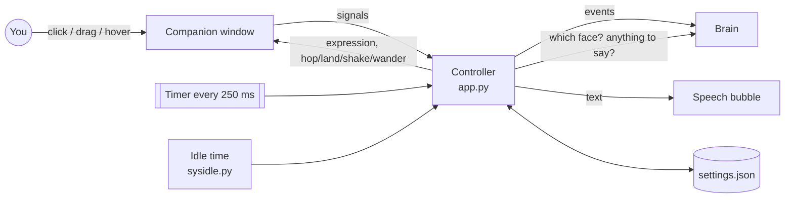

<div align="center">

# 📖 How DeskMate Works

### A guided tour: see-through windows, animation, a testable "brain", and the habits that make an app robust


[← Back to README](README.md)

</div>

> [!TIP]
> Keep the code open next to this page and do the 🧪 experiments. Change a number, run
> `run_deskmate.bat --console`, see what happens. That's how it sticks.

## 🗺️ Map

| # | Chapter | File | You'll learn |
|:-:|---|---|---|
| 1 | [The big picture](#1---the-big-picture) | all | How the pieces talk to each other |
| 2 | [A window you can see through](#2---a-window-you-can-see-through) | `companion.py` | Frameless, transparent, always-on-top windows |
| 3 | [Drawing her](#3---drawing-her) | `companion.py` | Image caching, HiDPI, crossfades, animation maths |
| 4 | [The brain](#4---the-brain) | `brain.py` | State machines you can unit-test with a fake clock |
| 5 | [Talking](#5---talking) | `bubble.py` | A typing effect that doesn't make words jump |
| 6 | [Never break, never get lost](#6---never-break-never-get-lost) | `settings.py`, `app.py` | Atomic saves, screen clamping, logging, one instance |
| 7 | [Character packs](#7---character-packs) | `character.py`, `tools/` | Validating input, and how the image clean-up works |
| 8 | [Bringing her to life](#8---bringing-her-to-life) | `companion.py`, `brain.py` | Blinking, gravity, throwing, wandering, frame-rate-proof physics |
| 9 | [Your turn](#9---your-turn) | | Challenges with hints |

---

## 1 · 🧩 The big picture



The most important design decision: **the window doesn't think, and the brain doesn't draw.**

- `companion.py` only knows *how to show* things (a picture, a hop, a swing).
- `brain.py` only knows *what she feels*. It has no Qt in it at all.
- `app.py` (the Controller) passes messages between them.

Because the brain is plain Python, all its rules are tested in milliseconds (`tests/test_brain.py`) without opening a single window.

---

## 2 · 🪟 A window you can see through

```python
flags = Qt.WindowType.FramelessWindowHint | Qt.WindowType.Tool | Qt.WindowType.WindowStaysOnTopHint
self.setAttribute(Qt.WidgetAttribute.WA_TranslucentBackground)
self.setAttribute(Qt.WidgetAttribute.WA_ShowWithoutActivating)
```

| Setting | Why |
|---|---|
| `FramelessWindowHint` | No title bar or border |
| `Tool` | No taskbar button |
| `WindowStaysOnTopHint` | Floats above other windows |
| `WA_TranslucentBackground` | Every pixel can have its own transparency (alpha) |
| `WA_ShowWithoutActivating` | Appearing doesn't steal focus from what you're typing in |

On Windows, a window like this becomes a *layered window*: fully transparent pixels let clicks fall through to whatever is underneath. DeskMate also double-checks in `_opaque_at()`, so a click on an empty corner is never treated as a pat.

> [!NOTE]
> Hiding the window must not quit the app, so `app.setQuitOnLastWindowClosed(False)` is set. Only **Quit** in the menu ends it.

<details>
<summary>🧪 <b>Experiment</b></summary>

In `companion.py`, temporarily remove `WA_TranslucentBackground` and run it. You'll see the black box that every desktop-pet beginner meets once. 🙂
</details>

---

## 3 · 🎨 Drawing her

### Scale once, not every frame

Her source images are big (about 1024 px tall) so she stays sharp on 4K screens. Shrinking a big image is slow, so `_pixmap()` does it **once** per size and keeps the result in `self._cache`. It also multiplies by the screen's *device pixel ratio* (1.25 at 125% Windows scaling), so she's crisp, not blurry, on every monitor. Moving her to a monitor with different scaling clears the cache.

### Crossfading faces

Swapping pictures instantly looks cheap. Drawing the old face on top of the new one at 50% looks ghostly. The trick is **Plus** blending in a scratch image:

```python
painter.setCompositionMode(QPainter.CompositionMode.CompositionMode_Plus)
painter.setOpacity(1.0 - k); painter.drawPixmap(0, 0, previous)
painter.setOpacity(k);       painter.drawPixmap(0, 0, current)
```

With pre-multiplied colours, that's exactly `(1-k)·old + k·new`, transparency included, which is a true cross-dissolve over 0.18 s.

### Animation is just maths on time

Nothing is a video. Every frame asks "what time is it?" and computes:

| Effect | Formula (simplified) |
|---|---|
| Breathing | `scale_y = 1 + 0.010 · sin(2π · t / 3.4)` (slower and deeper asleep) |
| Hop | `lift = height · 0.075 · 4p(1−p)` (a parabola, p goes 0→1) |
| Landing squash | `e^(−5p) · cos(3.2πp)` (a wobble that fades out) |
| Swing while dragged | a little spring: speed += (140·(target − angle) − 11·speed)·dt |

Scaling is done around her **feet**, so she breathes upward instead of sinking into the taskbar.

> [!IMPORTANT]
> The timer runs at about 30 fps only while something moves, and drops to about 15 fps when she's just breathing. When she's hidden, the timer stops. A desktop pet must be kind to your battery.

---

## 4 · 🧠 The brain

She has a **base mood** (lasts long) and a **reaction** (short, expires):

```
face = surprised        while you're dragging her
     = reaction         until it expires   (happy after a pat, talk while speaking…)
     = base mood        otherwise          (idle | sleepy | sleep | pouty)
```

`tick(now, user_idle)` runs four times a second and applies the rules in order: sleep/wake → late night → pout → blush → reminders → chit-chat → a stroll.

### Why `now` is passed in

```python
brain.tick(now=3600, user_idle=1)   # "an hour later", instantly
```

The brain never calls `time.time()` itself. Tests pass in any time they like, so "45 minutes ignored" is tested in a microsecond:

```python
def test_pouts_when_ignored_while_you_work_and_forgives_on_pet(self):
    brain.tick(B.IGNORED_AFTER + 1, user_idle=2)
    self.assertEqual(brain.base, "pouty")
```

This idea, **inject the clock**, is one of the most useful testing tricks in all of software.

### "Is the user away?"

`sysidle.py` asks Windows directly with `GetLastInputInfo`, which covers keyboard *and* mouse. The tick counter is 32-bit and wraps every 49.7 days, so the difference is masked with `& 0xFFFFFFFF`, a classic bug avoided. On other systems it falls back to watching the cursor.

<details>
<summary>🧪 <b>Experiment</b></summary>

Set `SLEEPY_AFTER = 20` and `SLEEP_AFTER = 40` in `brain.py`, start her, and don't touch anything for a minute. Then wiggle the mouse. (Put them back afterwards!)
</details>

---

## 5 · 💬 Talking

The bubble is a **separate** see-through window, so it can sit above her head without making her window bigger. If she's near the top of the screen it moves beside her head instead.

**The typing-effect problem:** if you draw only the first *n* letters, a half-typed word wraps differently from the finished word, and text jumps between lines. The fix is to lay out the **whole** sentence once, then draw the not-yet-typed part with an invisible colour:

```python
hidden.cursor = cursor          # selects letters n..end
invisible.setForeground(QColor(0, 0, 0, 0))
context.selections = [hidden]   # same layout, just not painted
```

---

## 6 · 🦺 Never break, never get lost

| Risk | Defence | Where |
|---|---|---|
| Power cut while saving → half a file | Write `settings.json.tmp`, then `os.replace` (atomic) | `settings.py` |
| Someone edits settings by hand and breaks it | Every value is validated, and a broken file is moved aside, not crashed on | `settings.py` |
| Antivirus locks the file for a moment | Retry 5 times with a short wait | `settings.py` |
| Monitor unplugged → she's off-screen | `clamped_pos()` on start, on drop, and when screens change | `companion.py`, `app.py` |
| No console (pythonw) → errors vanish | Rotating log file + `sys.excepthook` + Qt messages into the log | `logsetup.py` |
| Crash at start-up | `safe_main()` shows a message box with the log location | `app.py` |
| Double-clicking the launcher twice | Second copy finds the first through a local socket, says "show", and exits | `single_instance.py` |
| Missing / broken images | Pack is checked; missing faces fall back to idle; no idle → a placeholder | `character.py` |
| DeskMate folder moved | The "Start with Windows" entry repairs its own path | `autostart.py` |

---

## 7 · 🧱 Character packs

`character.py` reads only PNG **headers** (width, height, has-alpha) with `struct`, no image library needed, so `--check` is instant and has no dependencies:

```python
width, height, _depth, color_type = struct.unpack(">IIBB", data[:10])
has_alpha = color_type in (4, 6)
```

### How `tools/prepare_character.py` cleans pictures

1. **Cut out**: the `isnet-anime` model (via `rembg`) predicts which pixels are her.
2. **Tidy**: keep the big connected shape, drop specks, fill tiny holes.
3. **De-fringe**: an edge pixel is a mix: `seen = α·her + (1−α)·white`. Solve for `her` and the white halo disappears on dark wallpapers.
4. **Align**: find matching points on her **legs and shoes** (they don't change between expressions) and work out how far each picture is shifted. RANSAC throws away bad matches, and the median of the good ones is the shift. Only *moving* is allowed by default: when scaling was allowed, slightly narrower slippers in one picture fooled it into shrinking her by 4%. (`--allow-scale` turns it back on for pictures really drawn at different sizes.) A check makes sure her feet actually line up better; otherwise the original is kept.
5. **One canvas**: all expressions share a canvas centred on her feet, so the app can anchor every picture at the same point.

---

## 8 · 🍃 Bringing her to life

Phase 2 adds four things: **blinking, gravity, throwing and wandering**. They all live in `companion.py`, except *when* to wander, which is the brain's call.

### Blinking

```python
BLINK_SECONDS = 0.13          # how long her eyes stay shut
BLINK_GAP = (2.4, 6.0)        # random wait between blinks
DOUBLE_BLINK_CHANCE = 0.18    # sometimes she blinks twice
```

A blink isn't a mood, so the brain never hears about it. It's a 0.13 s swap to `blink/blink_01.png`, and only while she shows `idle` with no crossfade running (a blink in the middle of a fade looks like a glitch). The **random** gap is what makes it feel alive: blinking on a fixed beat looks robotic, and real people blink irregularly, sometimes twice in a row.

<details>
<summary>🎨 Where the blink picture came from</summary>

There was no "eyes closed" drawing, so `tools/make_blink.py` builds one from two pictures that already exist:

1. Find her irises in `idle` by their wisteria colour.
2. Paint over the open eyes with skin. Skin isn't one flat colour (it's lighter on one side), so it fits a gentle gradient, `colour = a·x + b·y + c`, to the skin around each eye and feathers the edge.
3. Cut the two closed-eyelid strokes out of `sleep` and place them where the eyes were, at the same tilt.

```powershell
.venv\Scripts\python tools\make_blink.py characters\yuki --preview blink_check.png
```
</details>

### Gravity in four lines

Every frame she moves a little, using her speed in **pixels per second**:

```python
self._fall_vy = min(MAX_FALL_SPEED, self._fall_vy + GRAVITY * dt)   # gravity speeds her up
self._fall_vx *= math.exp(-AIR_DRAG * dt)                            # air slows her sideways
self._fx += self._fall_vx * dt
self._fy += self._fall_vy * dt
```

| Detail | Why |
|---|---|
| Everything is multiplied by `dt` (seconds since the last frame) | She falls at the same speed at 15 fps, 30 fps, or on a busy PC |
| `dt` is capped at 0.1 s | If Windows freezes her for a second, she doesn't teleport through the floor |
| Slowing down is `exp(−k·dt)`, not "× 0.98 every frame" | A fixed factor per frame would slow her twice as fast at twice the frame rate |
| Her position is kept as floats (`_fx`, `_fy`), rounded only for `move()` | Rounding every frame throws away small steps, so slow movement would stutter |
| The floor is `availableGeometry().bottom()` | That's the top of the taskbar, on whichever screen is under her feet |
| Walls bounce back 45% of her speed; a hard landing bounces once, at 20% | Springy, but not a pinball |

`GRAVITY` is 3200 px/s². If 280 px is a 1.6 m girl, real gravity would be about 1700 px/s², but cartoon characters fall faster than real life, so the number was picked by eye: a drop from mid-screen takes about half a second.

### Throwing: how fast was the mouse moving?

When you let go, she flies off with your mouse's speed. Mouse events arrive at uneven times, so the speed is **smoothed** rather than taken from the last two events alone:

```python
self._vx = 0.6 * self._vx + 0.4 * (point.x() - last_x) / elapsed
```

While you hold her still, that speed fades away (`exp(−3.8·dt)` each frame), so carrying her somewhere and letting go gently doesn't fling her. When she lands, the `landed(impact)` signal tells the brain how hard she hit the ground: a big fall gets "Ow ow ow...", a soft one a happy face.

### Wandering: the brain says *when*, the window says *how*

```
brain.py       every 45–140 s, if she's idle, awake and you're around   →  "wander"
companion.py   if she's standing on the floor and not busy              →  hop-walk 120–380 px at 75 px/s
```

The brain just adds `"wander"` to the same queue as `"hop"` and `"shake"`. The window may say no (she's being carried, or falling), and that's fine. Thanks to this split, "she strolls every minute or two" is tested in `test_brain.py` without any window, and "she walks to the spot and stops" is tested in `test_qt_smoke.py` by stepping a fake clock frame by frame. The demo GIF in the README is recorded the same way (`tools/render_demo.py`): a pretend screen, a pretend clock, and the real window.

> [!TIP]
> If a pack has `walk/`, `fall/` or `drag/` pictures, they're used automatically while she walks, falls or is carried. Walk pictures are flipped when she heads left, so draw them facing right.

<details>
<summary>🧪 <b>Experiment</b></summary>

Set `GRAVITY = 900.0` in `companion.py` and throw her: she floats like she's on the Moon. Then try `WALL_BOUNCE = 1.0` for a bouncy castle. (Put them back afterwards!)
</details>

---

## 9 · 🏆 Your turn

### 🟢 Give her real legs
Right now she hop-walks. Draw a proper walk cycle.
<details><summary>💡 Hint</summary>

No code needed! Save 4 pictures of her walking, facing right, as `characters/yuki/walk/walk_01.png` … `walk_04.png` (same canvas size as `idle`, feet at the bottom centre). The app already uses them while she moves and flips them when she goes left. Set the speed in `character.json` with `"animations": {"walk": {"fps": 8}}`, then run `--check`.
</details>

### 🟡 A new mood: "excited"
Make her excited when you come back after more than an hour away.
<details><summary>💡 Hint</summary>

The brain already knows when you return (`_wake`). Remember *how long* you were away, pick `excited` (or `happy` + an extra hop) if it was more than 3600 s, and write a test first.
</details>

### 🟡 A hotkey
Press Ctrl+Alt+D anywhere to show/hide her.
<details><summary>💡 Hint</summary>

Global hotkeys need the OS: on Windows, `RegisterHotKey` via `ctypes` plus a native event filter. A good intro to how apps talk to Windows.
</details>

### 🟡 "Come here!"
When you come back after being away, she walks over to stand under your mouse.
<details><summary>💡 Hint</summary>

The brain knows when you return (`_wake`): queue a new animation such as `"come"`. In `app.py`'s `_apply`, turn it into `companion.start_wander(target_x=...)` using `QCursor.pos().x()`. `target_x` is the *window's* x, so subtract half her window width. Write the brain test first.
</details>

### 🔴 Sit on window edges
Drop her onto a window and she sits on its top edge, like the classic Shimeji pets.
<details><summary>💡 Hint</summary>

On Windows, list windows with `EnumWindows` + `IsWindowVisible` through `ctypes`, skipping minimised ones and "cloaked" ones on other virtual desktops (`DwmGetWindowAttribute` with `DWMWA_CLOAKED`). Use `DWMWA_EXTENDED_FRAME_BOUNDS` for the real frame, because `GetWindowRect` includes invisible borders. In `_fall_step`, a window's top edge counts as a floor if her feet cross it from above. Then check about once a second that the window is still there and hasn't moved, and let her fall if it has. Mind the scaling: Windows gives physical pixels, Qt uses logical ones (divide by `devicePixelRatio`).
</details>

---

<div align="center">

**You finished the tour! 🎉** Now go pat her.

[← Back to README](README.md)

</div>
