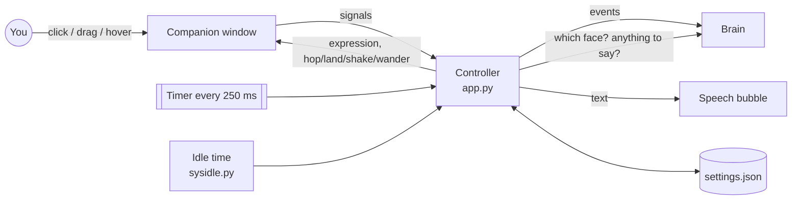
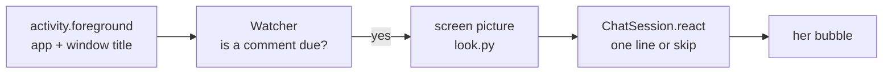
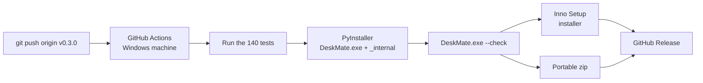

<div align="center">

# 📖 How DeskMate Works

### A guided tour: see-through windows, animation, a testable "brain", and the habits that make an app robust


[← Back to README](README.md)

</div>

> [!TIP]
> Keep the code open next to this page and do the 🧪 experiments. Change a number, run
> `run_deskmate.bat --console`, see what happens. That's how it sticks.

## 🗺️ Map

| # | Chapter | File | You'll learn |
|:-:|---|---|---|
| 1 | [The big picture](#1---the-big-picture) | all | How the pieces talk to each other |
| 2 | [A window you can see through](#2---a-window-you-can-see-through) | `companion.py` | Frameless, transparent, always-on-top windows |
| 3 | [Drawing her](#3---drawing-her) | `companion.py` | Image caching, HiDPI, crossfades, animation maths |
| 4 | [The brain](#4---the-brain) | `brain.py` | State machines you can unit-test with a fake clock |
| 5 | [Talking](#5---talking) | `bubble.py` | A typing effect that doesn't make words jump |
| 6 | [Never break, never get lost](#6---never-break-never-get-lost) | `settings.py`, `app.py` | Atomic saves, screen clamping, logging, one instance |
| 7 | [Character packs](#7---character-packs) | `character.py`, `tools/` | Validating input, and how the image clean-up works |
| 8 | [Bringing her to life](#8---bringing-her-to-life) | `companion.py`, `brain.py` | Blinking, gravity, throwing, wandering, frame-rate-proof physics |
| 9 | [Talking with AI](#9---talking-with-ai) | `chat.py`, `chatbox.py`, `activity.py`, `look.py` | OpenAI, Claude and Ollama, threads, prompts, buddy mode, testing with a fake server |
| 10 | [Shipping it](#10---shipping-it) | `packaging/`, `.github/workflows/` | PyInstaller, an installer, and CI/CD with GitHub Actions |
| 11 | [Your turn](#11---your-turn) | | Challenges with hints |

---

## 1 · 🧩 The big picture



The most important design decision: **the window doesn't think, and the brain doesn't draw.**

- `companion.py` only knows *how to show* things (a picture, a hop, a swing).
- `brain.py` only knows *what she feels*. It has no Qt in it at all.
- `app.py` (the Controller) passes messages between them.

Because the brain is plain Python, all its rules are tested in milliseconds (`tests/test_brain.py`) without opening a single window.

---

## 2 · 🪟 A window you can see through

```python
flags = Qt.WindowType.FramelessWindowHint | Qt.WindowType.Tool | Qt.WindowType.WindowStaysOnTopHint
self.setAttribute(Qt.WidgetAttribute.WA_TranslucentBackground)
self.setAttribute(Qt.WidgetAttribute.WA_ShowWithoutActivating)
```

| Setting | Why |
|---|---|
| `FramelessWindowHint` | No title bar or border |
| `Tool` | No taskbar button |
| `WindowStaysOnTopHint` | Floats above other windows |
| `WA_TranslucentBackground` | Every pixel can have its own transparency (alpha) |
| `WA_ShowWithoutActivating` | Appearing doesn't steal focus from what you're typing in |

On Windows, a window like this becomes a *layered window*: fully transparent pixels let clicks fall through to whatever is underneath. DeskMate also double-checks in `_opaque_at()`, so a click on an empty corner is never treated as a pat.

> [!NOTE]
> Hiding the window must not quit the app, so `app.setQuitOnLastWindowClosed(False)` is set. Only **Quit** in the menu ends it.

<details>
<summary>🧪 <b>Experiment</b></summary>

In `companion.py`, temporarily remove `WA_TranslucentBackground` and run it. You'll see the black box that every desktop-pet beginner meets once. 🙂
</details>

---

## 3 · 🎨 Drawing her

### Scale once, not every frame

Her source images are big (about 1024 px tall) so she stays sharp on 4K screens. Shrinking a big image is slow, so `_pixmap()` does it **once** per size and keeps the result in `self._cache`. It also multiplies by the screen's *device pixel ratio* (1.25 at 125% Windows scaling), so she's crisp, not blurry, on every monitor. Moving her to a monitor with different scaling clears the cache.

### Crossfading faces

Swapping pictures instantly looks cheap. Drawing the old face on top of the new one at 50% looks ghostly. The trick is **Plus** blending in a scratch image:

```python
painter.setCompositionMode(QPainter.CompositionMode.CompositionMode_Plus)
painter.setOpacity(1.0 - k); painter.drawPixmap(0, 0, previous)
painter.setOpacity(k);       painter.drawPixmap(0, 0, current)
```

With pre-multiplied colours, that's exactly `(1-k)·old + k·new`, transparency included, which is a true cross-dissolve over 0.18 s.

### Animation is just maths on time

Nothing is a video. Every frame asks "what time is it?" and computes:

| Effect | Formula (simplified) |
|---|---|
| Breathing | `scale_y = 1 + 0.010 · sin(2π · t / 3.4)` (slower and deeper asleep) |
| Hop | `lift = height · 0.075 · 4p(1−p)` (a parabola, p goes 0→1) |
| Landing squash | `e^(−5p) · cos(3.2πp)` (a wobble that fades out) |
| Swing while dragged | a little spring: speed += (140·(target − angle) − 11·speed)·dt |

Scaling is done around her **feet**, so she breathes upward instead of sinking into the taskbar.

> [!IMPORTANT]
> The timer runs at about 30 fps only while something moves, and drops to about 15 fps when she's just breathing. When she's hidden, the timer stops. A desktop pet must be kind to your battery.

---

## 4 · 🧠 The brain

She has a **base mood** (lasts long) and a **reaction** (short, expires):

```
face = surprised        while you're dragging her
     = reaction         until it expires   (happy after a pat, talk while speaking…)
     = base mood        otherwise          (idle | sleepy | sleep | pouty)
```

`tick(now, user_idle)` runs four times a second and applies the rules in order: sleep/wake → late night → pout → blush → reminders → chit-chat → a stroll.

### Why `now` is passed in

```python
brain.tick(now=3600, user_idle=1)   # "an hour later", instantly
```

The brain never calls `time.time()` itself. Tests pass in any time they like, so "45 minutes ignored" is tested in a microsecond:

```python
def test_pouts_when_ignored_while_you_work_and_forgives_on_pet(self):
    brain.tick(B.IGNORED_AFTER + 1, user_idle=2)
    self.assertEqual(brain.base, "pouty")
```

This idea, **inject the clock**, is one of the most useful testing tricks in all of software.

### "Is the user away?"

`sysidle.py` asks Windows directly with `GetLastInputInfo`, which covers keyboard *and* mouse. The tick counter is 32-bit and wraps every 49.7 days, so the difference is masked with `& 0xFFFFFFFF`, a classic bug avoided. On other systems it falls back to watching the cursor.

<details>
<summary>🧪 <b>Experiment</b></summary>

Set `SLEEPY_AFTER = 20` and `SLEEP_AFTER = 40` in `brain.py`, start her, and don't touch anything for a minute. Then wiggle the mouse. (Put them back afterwards!)
</details>

---

## 5 · 💬 Talking

The bubble is a **separate** see-through window, so it can sit above her head without making her window bigger. If she's near the top of the screen it moves beside her head instead.

**The typing-effect problem:** if you draw only the first *n* letters, a half-typed word wraps differently from the finished word, and text jumps between lines. The fix is to lay out the **whole** sentence once, then draw the not-yet-typed part with an invisible colour:

```python
hidden.cursor = cursor          # selects letters n..end
invisible.setForeground(QColor(0, 0, 0, 0))
context.selections = [hidden]   # same layout, just not painted
```

---

## 6 · 🦺 Never break, never get lost

| Risk | Defence | Where |
|---|---|---|
| Power cut while saving → half a file | Write `settings.json.tmp`, then `os.replace` (atomic) | `settings.py` |
| Someone edits settings by hand and breaks it | Every value is validated, and a broken file is moved aside, not crashed on | `settings.py` |
| Antivirus locks the file for a moment | Retry 5 times with a short wait | `settings.py` |
| Monitor unplugged → she's off-screen | `clamped_pos()` on start, on drop, and when screens change | `companion.py`, `app.py` |
| No console (pythonw) → errors vanish | Rotating log file + `sys.excepthook` + Qt messages into the log | `logsetup.py` |
| Crash at start-up | `safe_main()` shows a message box with the log location | `app.py` |
| Double-clicking the launcher twice | Second copy finds the first through a local socket, says "show", and exits | `single_instance.py` |
| Missing / broken images | Pack is checked; missing faces fall back to idle; no idle → a placeholder | `character.py` |
| DeskMate folder moved | The "Start with Windows" entry repairs its own path | `autostart.py` |

---

## 7 · 🧱 Character packs

`character.py` reads only PNG **headers** (width, height, has-alpha) with `struct`, no image library needed, so `--check` is instant and has no dependencies:

```python
width, height, _depth, color_type = struct.unpack(">IIBB", data[:10])
has_alpha = color_type in (4, 6)
```

### How `tools/prepare_character.py` cleans pictures

1. **Cut out**: the `isnet-anime` model (via `rembg`) predicts which pixels are her.
2. **Tidy**: keep the big connected shape, drop specks, fill tiny holes.
3. **De-fringe**: an edge pixel is a mix: `seen = α·her + (1−α)·white`. Solve for `her` and the white halo disappears on dark wallpapers.
4. **Align**: find matching points on her **legs and shoes** (they don't change between expressions) and work out how far each picture is shifted. RANSAC throws away bad matches, and the median of the good ones is the shift. Only *moving* is allowed by default: when scaling was allowed, slightly narrower slippers in one picture fooled it into shrinking her by 4%. (`--allow-scale` turns it back on for pictures really drawn at different sizes.) A check makes sure her feet actually line up better; otherwise the original is kept.
5. **One canvas**: all expressions share a canvas centred on her feet, so the app can anchor every picture at the same point.

---

## 8 · 🍃 Bringing her to life

Phase 2 adds four things: **blinking, gravity, throwing and wandering**. They all live in `companion.py`, except *when* to wander, which is the brain's call.

### Blinking

```python
BLINK_SECONDS = 0.13          # how long her eyes stay shut
BLINK_GAP = (2.4, 6.0)        # random wait between blinks
DOUBLE_BLINK_CHANCE = 0.18    # sometimes she blinks twice
```

A blink isn't a mood, so the brain never hears about it. It's a 0.13 s swap to `blink/blink_01.png`, and only while she shows `idle` with no crossfade running (a blink in the middle of a fade looks like a glitch). The **random** gap is what makes it feel alive: blinking on a fixed beat looks robotic, and real people blink irregularly, sometimes twice in a row.

<details>
<summary>🎨 Where the blink picture came from</summary>

There was no "eyes closed" drawing, so `tools/make_blink.py` builds one from two pictures that already exist:

1. Find her irises in `idle` by their wisteria colour.
2. Paint over the open eyes with skin. Skin isn't one flat colour (it's lighter on one side), so it fits a gentle gradient, `colour = a·x + b·y + c`, to the skin around each eye and feathers the edge.
3. Cut the two closed-eyelid strokes out of `sleep` and place them where the eyes were, at the same tilt.

```powershell
.venv\Scripts\python tools\make_blink.py characters\yuki --preview blink_check.png
```
</details>

### Gravity in four lines

Every frame she moves a little, using her speed in **pixels per second**:

```python
self._fall_vy = min(MAX_FALL_SPEED, self._fall_vy + GRAVITY * dt)   # gravity speeds her up
self._fall_vx *= math.exp(-AIR_DRAG * dt)                            # air slows her sideways
self._fx += self._fall_vx * dt
self._fy += self._fall_vy * dt
```

| Detail | Why |
|---|---|
| Everything is multiplied by `dt` (seconds since the last frame) | She falls at the same speed at 15 fps, 30 fps, or on a busy PC |
| `dt` is capped at 0.1 s | If Windows freezes her for a second, she doesn't teleport through the floor |
| Slowing down is `exp(−k·dt)`, not "× 0.98 every frame" | A fixed factor per frame would slow her twice as fast at twice the frame rate |
| Her position is kept as floats (`_fx`, `_fy`), rounded only for `move()` | Rounding every frame throws away small steps, so slow movement would stutter |
| The floor is `availableGeometry().bottom()` | That's the top of the taskbar, on whichever screen is under her feet |
| Walls bounce back 45% of her speed; a hard landing bounces once, at 20% | Springy, but not a pinball |

`GRAVITY` is 3200 px/s². If 280 px is a 1.6 m girl, real gravity would be about 1700 px/s², but cartoon characters fall faster than real life, so the number was picked by eye: a drop from mid-screen takes about half a second.

### Throwing: how fast was the mouse moving?

When you let go, she flies off with your mouse's speed. Mouse events arrive at uneven times, so the speed is **smoothed** rather than taken from the last two events alone:

```python
self._vx = 0.6 * self._vx + 0.4 * (point.x() - last_x) / elapsed
```

While you hold her still, that speed fades away (`exp(−3.8·dt)` each frame), so carrying her somewhere and letting go gently doesn't fling her. When she lands, the `landed(impact)` signal tells the brain how hard she hit the ground: a big fall gets "Ow ow ow...", a soft one a happy face.

### Perching: windows are just more floors

`perch.py` asks Windows for the open windows (`EnumWindows`, through `ctypes`) and turns each one into a **ledge**: its left, right and top in Qt's pixels. It skips minimised, maximised and invisible windows, windows on other virtual desktops ("cloaked"), and DeskMate's own windows.

The physics doesn't know about Windows at all. Each frame while she falls, `_ledge_below()` asks one question: *did her feet just pass through the top of a ledge?*

```python
if ledge.holds(feet_x) and old_feet <= ledge.top <= new_feet and not covered(ledges, ledge, feet_x):
    land_on(ledge)
```

`covered()` checks the stacking order (`z`), so she won't land on a window top that's hidden behind another window. While she sits, `check_perch()` re-reads her window about 3 times a second: it moved → she moves by the same amount; it's gone → she falls.

Two details that bite everyone who tries this:

| Gotcha | Fix |
|---|---|
| `GetWindowRect` includes Windows 10/11's invisible resize borders, so the edges it reports are a little off from what you see | Ask DWM for `DWMWA_EXTENDED_FRAME_BOUNDS`, the frame you actually see |
| Windows reports physical pixels; Qt uses logical ones (125% scaling: 1.25 physical per logical) | `qt_to_logical()` converts per monitor, so mixed-scaling setups work |

Because the physics only sees plain ledges, `test_perching_on_windows` can fake windows (open, move, close) and run on any computer. Only the small Windows-reading part needs a real Windows machine, and GitHub's runs it on every push.

### Wandering: the brain says *when*, the window says *how*

```
brain.py       every 45–140 s, if she's idle, awake and you're around   →  "wander"
companion.py   if she's standing on the floor and not busy              →  hop-walk 120–380 px at 75 px/s
```

The brain just adds `"wander"` to the same queue as `"hop"` and `"shake"`. The window may say no (she's being carried, or falling), and that's fine. Thanks to this split, "she strolls every minute or two" is tested in `test_brain.py` without any window, and "she walks to the spot and stops" is tested in `test_qt_smoke.py` by stepping a fake clock frame by frame. The demo GIF in the README is recorded the same way (`tools/render_demo.py`): a pretend screen, a pretend clock, and the real window.

> [!TIP]
> If a pack has `walk/`, `fall/` or `drag/` pictures, they're used automatically while she walks, falls or is carried. Walk pictures are flipped when she heads left, so draw them facing right.

<details>
<summary>🧪 <b>Experiment</b></summary>

Set `GRAVITY = 900.0` in `companion.py` and throw her: she floats like she's on the Moon. Then try `WALL_BOUNCE = 1.0` for a bouncy castle. (Put them back afterwards!)
</details>

---

## 9 · 🧠 Talking with AI

Phase 3 lets you type to her. Three files: `chat.py` (talks to the model, no Qt at all), `chatbox.py` (the text box and the settings dialog), and a few methods in `app.py` that connect them.

### Three brains, two protocols

OpenAI's **chat completions** format became the common language: OpenAI speaks it, and so does Ollama on your own PC. So DeskMate needs just one function:

```python
POST {url}/chat/completions
{"model": "gpt-...-mini",
 "messages": [{"role": "system", "content": "You are Yuki..."},
              {"role": "user", "content": "hi!"}]}
→ {"choices": [{"message": {"content": "[happy] Hi~ you're back!"}}]}
```

Switching between OpenAI and Ollama only changes the address (`https://api.openai.com/v1` or `http://localhost:11434/v1`) and whether a key is sent. It uses Python's built-in `urllib`, so there's no new package to install.

**Claude** speaks Anthropic's own *Messages* format, so `ChatSession.ask` has one small branch for it:

| | OpenAI / Ollama | Claude |
|---|---|---|
| Address | `.../chat/completions` | `https://api.anthropic.com/v1/messages` |
| Key | `Authorization: Bearer ...` | `x-api-key: ...` plus an `anthropic-version` header |
| Her persona | the first message, `role: "system"` | a separate top-level `"system"` field |
| Length limit | optional | `"max_tokens"` is required |
| The answer | `choices[0].message.content` | `content`: a list of blocks; join the `"text"` ones |

Everything around it (her mood tag, reminders, today's memory, the fake-server tests) is shared.

### Never freeze the window

A reply can take a few seconds. If the request ran on the Qt thread, she'd freeze mid-breath and you couldn't drag her. So `Background.run()` does the slow part on a thread and sends the result back with a **signal**:

```python
threading.Thread(target=lambda: self._done.emit(callback, work())).start()
```

Qt delivers a signal emitted from another thread on the main thread (a *queued connection*), so the callback can safely touch widgets. Rule of thumb: **threads may compute, only the main thread may touch widgets.**

### The prompt is the character

Everything that makes her *Yuki* is in the messages, rebuilt for every question:

| Part | Where it comes from |
|---|---|
| Who she is | `persona_prompt()`: name, personality and `persona` from `character.json` |
| How to answer | "1–2 short sentences", "no markdown" (it's a small bubble) |
| Her face | "Start every reply with your mood: `[happy]`, `[blush]`…", split off by `parse_reply()` |
| Right now | `situation()`: the time, her mood, how long you've worked without a break |
| Memory | today's last 12 messages, saved in `chat_<character>.json` |

The mood tag is a nice trick: one answer carries both the words *and* the expression, and `parse_reply()` still copes when the model forgets it (unknown or missing → `talk`).

### Reminders: letting the model *do* something

A chat model only produces text. To let her actually set a reminder, the prompt teaches her a tiny tag:

```
[happy] Okay~ I'll tell you at 3! <remind when="3pm">the meeting</remind>
```

`extract_reminders()` cuts the tag out (so it never shows in the bubble), and the app turns `when` into a real time with `reminders.parse_when()`: the same parser the **Add reminder...** box uses, so both paths are tested by the same tests. If the model writes a time the parser doesn't understand, she says so instead of silently forgetting. Big AI apps call this idea *tool use* or *function calling*; this is the hand-made version.

The time parser is a good example of testing many small cases: `tests/test_reminders.py` checks `3pm`, `15:00`, `in 20 min`, `1h30`, and also what must **not** count as a time (`10 push-ups` is not "in 10 minutes").

### Her voice: two engines, one decision-maker

`voice.py` has two very different engines behind one `Speaker`:

| | Windows voice | OpenAI voice |
|---|---|---|
| How | A hidden PowerShell runs .NET's `System.Speech` | `POST /audio/speech` returns a WAV clip, played with Python's `winsound` |
| Text goes in via | the program's **input** (never inside the command, so no quoting bugs or injection) | the JSON body |
| Speed | instant | needs the network, so it runs on a thread |

Two small ideas keep it pleasant:

- **Newest line wins.** Each line gets a number (`_turn`). If an older clip arrives after she has already moved on, it's quietly dropped.
- **Graceful fallback.** If the OpenAI clip fails, the same line is spoken by the Windows voice instead of silence.
- **Knowing when to be quiet.** `Speaker` takes a `hush()` check: while the window you're using is a call (Teams, Zoom, Meet, the same `Activity.quiet` rule buddy mode uses), lines are shown but not spoken. If that check ever fails, she speaks rather than going mute forever.

**More voices without more code.** Two small changes opened the door to lots of voices:

- The Windows engine already knew every installed voice; it just always grabbed the first female one. Now the hidden PowerShell gets the voice's *name* on the first line of its input, then the text (`SelectVoice(name)`, falling back to the first female voice if that name is gone). A second tiny script lists the installed voices as JSON for the picker. Anything that registers itself as a Windows voice (a language pack, NaturalVoiceSAPIAdapter) just appears.
- The Natural voice spoke OpenAI's `/audio/speech` protocol, and so do local servers like Kokoro-FastAPI. So "your own server" is the same `OpenAIVoice` with a different `base_url` and no key, exactly like Ollama for chat. Only two things differ: voice names come from the server (`GET /audio/voices`), and OpenAI-only extras (the "speak softly" `instructions`) aren't sent.

Supporting a *protocol* instead of a *company* is what makes this cheap: one class, many voices.

**"It worked, but there's no sound."** The first real test with Kokoro played nothing, and said nothing either. Two lessons:

- *Streamed* WAV files don't know their length when the header is written, so they put 0 or `0xFFFFFFFF` there. Browsers shrug; Windows' `PlaySound` silently refuses. DeskMate now asks for one whole clip (`"stream": false`), and `fix_wav()` repairs such headers anyway (it walks the RIFF chunks, finds `data`, and writes the real sizes).
- A Chinese voice given an English sentence can return silence. `fix_wav()` checks the loudest sample, and the dialog now shows each voice's language (Kokoro names start with it: `zf_` = Chinese, female) and tests it with a sentence in that language.

**Showing one language, speaking another.** With a Japanese voice, the user wanted to *hear* Japanese but *read* English. Each line she says can now carry a second version: `Speech(text, duration, kind, spoken)`. Where does `spoken` come from?

- **Chat replies and buddy comments:** `spoken_prompt("Japanese")` asks her chat brain to add `<say>…</say>` with the same line in Japanese, in the *same* answer, so there's no extra request and no extra wait. `extract_spoken()` takes it out (like `<remind>` and `<remember>`), and it's never saved to the chat history.
- **Her fixed lines** (from `character.json`) have no chat brain behind them, so `Speaker` calls `translate(line, "Japanese")` on a background thread. The app keeps every translation in `voice_lines.json`, so "Drink some water~" costs one request ever, not one per reminder.
- If translating fails, she says it in English; if the Natural voice fails, the Windows fallback gets the *English* line (it probably can't speak Japanese).

The general habit: when something can fail *quietly* (a sound that doesn't play, a file that's empty), check for it yourself and turn it into a message a person can act on.

`Speaker` never touches Qt or the sound card directly: it's given the engines and a "run this in the background" function. So the tests hand it fake engines and check *what* she would say, without making a sound.

### Buddy mode: she watches with you

The idea: she notices what you're doing and reacts like a friend next to you. It's built from four small pieces, each easy to test on its own:



**1. What are you on? (free, local)** Every 2 seconds `activity.foreground()` asks Windows for the window you're using: `GetForegroundWindow` → `GetWindowTextW` for the title, and `QueryFullProcessImageNameW` for the program. `make_activity()` turns `chrome.exe` + `"lofi hip hop radio - YouTube - Google Chrome"` into `Activity("Chrome", "lofi hip hop radio - YouTube")`. The window title alone already says a lot, costs nothing, and never leaves your PC.

**2. Is a comment due? (pure logic)** `Watcher.observe(now, activity)` is a small state machine, like the brain, tested with fake times:

| Rule | Why |
|---|---|
| You stayed on it for 8 s (`settle`) | No comments while you Alt+Tab around |
| `gap` since her last comment, at most `per_hour` | A buddy, not a commentator |
| Not the same `key` in the last 30 min | `key` drops counters like `(3)`, so a new notification isn't "something new" |
| Not `private`, not `quiet` | Incognito, password managers, banking: never. Calls: stay quiet |
| `hold()` while you chat | She doesn't talk over you |

**3. Seeing without being seen.** She's always on top, so a plain screen picture would mostly show… her. `SetWindowDisplayAffinity(hwnd, WDA_EXCLUDEFROMCAPTURE)` asks Windows to leave a window out of screen captures while still showing it to you. The first version switched it on for the whole time she watched, and the first real test showed the catch: she vanished from the user's *own* screenshots too. Now `_capture()` switches it on, waits 120 ms (`EXCLUDE_MS`) for Windows to apply it, takes the picture, and switches it off again. So it's "invisible to cameras" for a fraction of a second, not for an hour. On older systems the app falls back to making her see-through for 250 ms while the picture is taken.

**Photograph the right thing.** The first version took the screen under the *mouse*. In the first real test, the user opened YouTube Music and she talked about a different window that was still on screen. Now `foreground()` also reads the window's frame (`DwmGetWindowAttribute`, the same call perching uses), and `crop_to_window()` cuts the picture down to just that window, on whichever monitor it's on. It's sharper (fewer pixels wasted), cheaper, and more private: your other monitor never leaves the PC.

**4. One line, or nothing.** `ChatSession.react()` sends the picture with `BUDDY_PROMPT`: say ONE short, specific line ("Ooh, lo-fi~ is this your study playlist?"), or reply exactly `[skip]` if there's nothing worth saying. Giving the model a way to stay quiet matters as much as telling it what to say. Without it, she'd comment on every spreadsheet. Her line is saved in today's chat (with what it was about), so when you answer "yes I love it", she knows what you mean.

**Watching is a background job, not a mood.** At first her buddy comments went through `brain.on_chat_reply()`, which also starts a 90-second "you're chatting with me" quiet time (no strolls, no chit-chat, so she doesn't wander off mid-conversation). With a comment every few minutes, she was quiet *almost all the time* and just stood there. Buddy comments now use `brain.on_buddy_line()`: it shows the line with its mood, but doesn't count as you chatting (and doesn't count as you saying hi, either), so everything else she does carries on. One brain method per *meaning* ("you talked to me" vs "I said something") keeps that difference explicit.

**Answers you can tap.** If her line is a question, the prompt asks her to add two answers you might give: `<replies>Yes, I love it!|Just background</replies>`. `extract_replies()` takes the tag out (like reminders), and `QuickReplies` shows them as chips by her bubble. Tapping one sends it through the normal chat path, so it's exactly as if you'd typed it. If she asks but forgets the tag, there's a plain *Yes! / Not really* fallback. Letting the model write the choices makes them fit the question, which fixed buttons never could.

**Hearing the music.** A song in the background never becomes the foreground window, so `now_playing()` looks at *every* window's title: Spotify's is `Artist - Song` while playing (just `Spotify Premium` when paused), and a YouTube Music tab is `Song - YouTube Music`. There's a second `Watcher` for songs, with a bigger gap (`Watcher.for_music`), so she reacts to a few songs an hour, not every track. And `Activity.key` treats every YouTube Music / Spotify window title as the *same* app, so a new song doesn't also look like "you opened something new" to the first Watcher. Two watchers, one rule between them: after either one speaks, the other waits (`other.hold(now)`).

**Late is wrong.** Her brain takes a few seconds. If you've switched to something else by the time she answers, her comment would look like it's about the *new* thing. So `_on_react` checks what you're on *now*, and drops the comment if it changed. It's only saved to today's chat (`remember_reaction`) once it's really shown.

**Same picture, two shapes.** OpenAI/Ollama and Claude both take the picture inside your message, but in different shapes:

```python
# OpenAI and Ollama                                # Claude
{"role": "user", "content": [                      {"role": "user", "content": [
  {"type": "text", "text": "what's wrong?"},         {"type": "image", "source": {"type": "base64",
  {"type": "image_url", "image_url":                   "media_type": "image/jpeg", "data": "..."}},
     {"url": "data:image/jpeg;base64,..."}}]}        {"type": "text", "text": "what's wrong?"}]}
```

`image_message()` builds the right one. The picture rides along **only on the newest message**; older turns are sent as text, so a long chat doesn't resend old pictures.

**Asking for help while she watches.** If you ask about something on screen, `LOOK_PROMPT` lets her answer in two parts split by `---`: one line for the bubble, then **steps**, a short **example**, or **one question back** if she can't tell what you need. `split_look_reply()` cuts it in two (and copes when the model forgets the `---`). The chat window shows the second part as rich text: `details_html()` escapes everything first, then puts code in a light box. Two Qt gotchas found on the way: `QLabel` already has a property called `text`, so `setProperty("text", ...)` silently replaced the rich text; and a rich-text label in nested layouts needs `setMinimumHeight(heightForWidth(...))`, or it's squashed to one line.

**Permission is a feature.** `WatchDialog` asks every time (nothing is remembered as "yes forever"), a small 👁 `WatchBadge` sits by her head the whole time (half see-through, so it doesn't steal attention) and stops it with one click, and a time limit ends it by itself. Being watched should never be a surprise.

### Remembering you across days

Today's chat is forgotten at midnight on purpose (it would grow forever). What's worth keeping goes to `memory.py`, in three kinds, each made a different way:

| Kind | Made by | Costs |
|---|---|---|
| **Facts** ("Birthday is 12 May") | The model adds `<remember>…</remember>` to a reply when you say something worth keeping, and `<forget>…</forget>` when you ask | Nothing extra: it's part of the reply she was writing anyway |
| **Diary** ("You fixed the perch bug…") | `ChatSession.summarize_day()`, one small request the next time she starts (or right after midnight) | One short request a day |
| **Habits** ("listens to GLORIA, 5x") | Buddy mode counts what you stay on for a minute (`memory.habit_of`) | Nothing: counted on your PC |

It's the same trick as reminders: rather than a second "extract the facts" request after every message, the prompt teaches her a tag, and `extract_memory()` cuts it out. Instructions about *when* to use it matter as much as the tag: "something they like or dislike, a project, a plan, a name, a date… not small talk… never passwords, money, health".

**Same fact, newer words.** "Likes YUI" and later "Likes YUI's songs, especially GLORIA" shouldn't be two facts. `remember()` compares simplified versions (lowercase, no punctuation, no little words like *the*/*my*) and replaces the old one if one contains the other. A small rule, but it keeps the list readable.

**What goes into her prompt is small on purpose:** the 15 newest facts, the last 3 diary days (with "yesterday" instead of a date, so she says it naturally), and the 6 most frequent habits from the last two weeks, with "mention now and then, not every time" so she doesn't bring up YUI in every reply.

**Memory you can see is memory you can trust.** Everything she remembers is in one window with a ✕ per line, "Forget everything", and a switch to turn it off. The file is about *you*, so every character shares it.

### Failing gently

Every problem becomes a `ChatError` with a `kind` (`no_key`, `auth`, `quota`, `vision`, `offline`, …), and each kind has a line in her own voice (`OFFLINE_LINES`). The technical detail goes to the log, never the key itself.

### Testing without a key

`tests/fake_openai.py` is a tiny HTTP server on `127.0.0.1` that pretends to be OpenAI. The tests point DeskMate at it and check what was sent (persona first, your message last, the `Bearer` key) and what happens with a wrong key or a 429. They even click through the real chat box. No internet, no cost, and the tests run in seconds.

> [!WARNING]
> An API key is like a password that can spend money. That's why it lives in `%APPDATA%\DeskMate\secrets.json` and not in `settings.json` or the project folder (which goes to GitHub), and why the settings box shows only `sk-...abcd`.

<details>
<summary>🧪 <b>Experiment</b></summary>

Edit `"persona"` in `characters/yuki/character.json` (say, make her talk like a pirate), restart, and chat. Then change `HISTORY_TURNS` in `chat.py` to `2` and see how quickly she forgets.
</details>

---

## 10 · 📦 Shipping it

Running from source needs Python. Real users want a download that just works. Three tools turn the code into that, and GitHub runs them for you.



### 1. PyInstaller: Python into an .exe

`packaging/deskmate.spec` is the recipe. PyInstaller follows every `import`, copies Python itself, PySide6 and the `characters/` folder, and writes `DeskMate.exe`.

| Choice | Why |
|---|---|
| **onedir** (an exe + `_internal` folder), not onefile | A single-file exe unpacks itself to a temp folder on *every* launch: slower, and antivirus tools dislike it |
| `console=False` | No black window behind her |
| `upx=False` | Compressed exes look suspicious to antivirus software |
| Drop Qt translations and `opengl32sw.dll` | About 25 MB she never uses |
| `hiddenimports=["deskmate.chat", ...]` | Those are imported *inside functions*, which PyInstaller can't see |

The classic packaging bug: files aren't where the code expects. Inside the exe, `__file__` points somewhere odd, so `paths.py` asks `sys.frozen` and `sys._MEIPASS` where the bundled files really are. `test_packaged_app_finds_its_bundled_characters` pretends to be frozen to test exactly that.

### 2. Inno Setup: the installer

`packaging/installer.iss` makes `DeskMate-Setup-0.3.0.exe`:

- `PrivilegesRequired=lowest`: installs into your own `%LOCALAPPDATA%\Programs`, so **no admin prompt**.
- The fixed `AppId` is how Windows knows 0.4.0 is an *upgrade* of 0.3.0, not a second app.
- `CloseApplications=yes` closes a running DeskMate before replacing files (Windows can't overwrite a running exe).
- The uninstaller removes the "Start with Windows" entry, but keeps `%APPDATA%\DeskMate` (your settings and key).

### 3. GitHub Actions: CI/CD

Two workflow files in `.github/workflows/`:

| File | When | What |
|---|---|---|
| `ci.yml` | every push and pull request | tests on Windows (Python 3.10 and 3.13) and Linux, then a test build of the exe |
| `release.yml` | the **Run workflow** button, or pushing a tag like `v0.3.0` | tests, build, `--check`, zip, installer, checksums, GitHub Release |

**CI** (continuous integration) means every change is tested on clean machines, so "works on my PC" isn't enough. **CD** (continuous delivery) means releasing is one command, done the same way every time. The release job also refuses to run if the tag doesn't match `__version__`, a small guard against a very common mistake.

> [!TIP]
> Read `release.yml` top to bottom: it's just the steps you'd do by hand, written down. That's most of what DevOps automation is.

<details>
<summary>🧪 <b>Experiment</b></summary>

Break a test on purpose (say, change an expected value in `tests/test_chat.py`), push, and watch the **Actions** tab on GitHub turn red, with the exact failing line. Then fix it and watch it go green.
</details>

---

## 11 · 🏆 Your turn

### 🟢 A waving animation
Make her wave when you come back to your PC.
<details><summary>💡 Hint</summary>

Make 2–3 pictures of her waving and add them with `tools/add_frames.py characters\yuki wave wave1.png wave2.png --fps 5` (that's how her walk cycle was added). Then have the brain show `wave` instead of `surprised` in `_wake`, and read `tools/add_frames.py` to see how it keeps her head steady between frames.
</details>

### 🟡 A new mood: "excited"
Make her excited when you come back after more than an hour away.
<details><summary>💡 Hint</summary>

The brain already knows when you return (`_wake`). Remember *how long* you were away, pick `excited` (or `happy` + an extra hop) if it was more than 3600 s, and write a test first.
</details>

### 🟡 A hotkey
Press Ctrl+Alt+D anywhere to show/hide her.
<details><summary>💡 Hint</summary>

Global hotkeys need the OS: on Windows, `RegisterHotKey` via `ctypes` plus a native event filter. A good intro to how apps talk to Windows.
</details>

### 🟡 "Come here!"
When you come back after being away, she walks over to stand under your mouse.
<details><summary>💡 Hint</summary>

The brain knows when you return (`_wake`): queue a new animation such as `"come"`. In `app.py`'s `_apply`, turn it into `companion.start_wander(target_x=...)` using `QCursor.pos().x()`. `target_x` is the *window's* x, so subtract half her window width. Write the brain test first.
</details>

### 🟡 One-click update
She already tells you when a new version is out (`updates.py`). Make **Update** download the installer and run it for you.
<details><summary>💡 Hint</summary>

The release JSON has an `assets` list with each file's `browser_download_url`. Download `DeskMate-Setup-*.exe` on a thread to `%TEMP%`, check its SHA-256 against `SHA256SUMS.txt` from the same release (never run a file you haven't verified!), then start it with `/SILENT` and quit DeskMate so the installer can replace her.
</details>

### 🔴 Peek from behind a window
When she's sitting on a window and you drag another window over her, she ducks down and peeks over its edge.
<details><summary>💡 Hint</summary>

`perch.covered()` already knows when a spot is hidden by a window in front. In `check_perch`, test her head instead of her feet; if it's covered, show a `peek` animation and move her down a little. Read how `test_perching_on_windows` fakes the windows, and write the test first.
</details>

---

<div align="center">

**You finished the tour! 🎉** Now go pat her.

[← Back to README](README.md)

</div>
